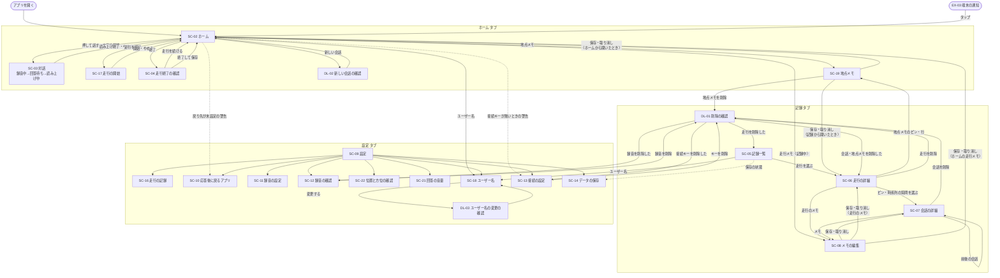
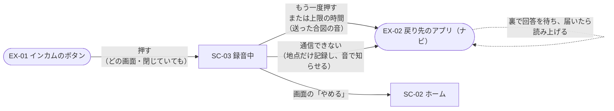
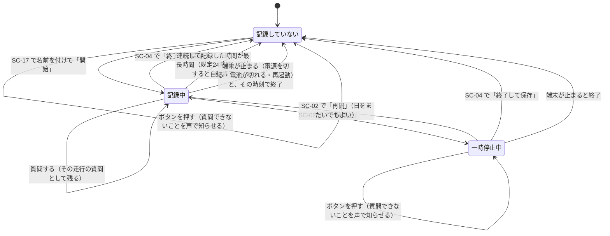

# 画面遷移図

画面の ID と役割は [画面一覧](02_screen_list.md)。

## 1. 全体

タブ（ホーム・記録・設定）の間はいつでも行き来できるので、図ではタブの切り替えを省き、各タブの中のつながりだけを描く。
記録タブは走行ごとに見る（[adr/0008](../adr/0008-ask-only-while-recording.md)）。

## 2. ハンズフリーの一巡

走行中は画面を操作しないので、インカムのボタンと時間の経過だけで画面が進む。
戻り先のアプリがあるときは、速やかにナビへ戻ることを優先する。下の図は既定（送ったらすぐ戻る）の場合。

- 失敗したときは、ナビを表示したまま端末の音声で知らせる。
- 戻らない設定のとき・画面から質問したときに通信できなければ、SC-03 の「通信できない」を出し、5秒で自動で閉じて SC-02 に戻る。
- 戻るタイミング（SC-10）を「回答が届いたら」にすると回答待ち（SC-03）を、「読み上げが終わったら」にすると回答待ちと読み上げ中（SC-03）を出してから戻る。
- 戻り先が「戻らない」のとき、または画面から質問したときは、録音中→回答待ち→読み上げ中（SC-03）を出し、読み上げが終わると SC-02 に戻る。文字で質問したときは、回答待ちから始まる。文字の質問で通信できないときは、地点を記録せず、入力のシートに文を残したまま知らせる。
- 質問を受けるのは走行の記録中だけ。走行を記録していないとき・一時停止中にインカムのボタンを押すと、録音を始めず、質問できないことを端末の音声で知らせる（ナビを表示したまま）。画面の「押して話す」は押せない形にする（[adr/0008](../adr/0008-ask-only-while-recording.md)）。
- SC-19（地点メモ）を開いているあいだは、インカムのボタンで質問を始めず、声の入力の開始と停止に使う（停車中に手袋のままでも書けるように）。

## 3. 走行の記録の状態

- 一時停止中はルートを記録しない。地図では一時停止の前後を破線で結ぶ。
- 走行は日をまたいでよい。最長時間は一時停止せずに連続して記録した時間で数え、再開で数え直す。一時停止中は数えないので、一時停止中に自動終了はしない。最長時間は SC-16 で変えられる。
- アプリだけが落ちたときは、走行は終わらず記録を続ける。
- 質問は、始めたときに記録していた走行に入り、走行の詳細（SC-06）に出る。始めた質問は、途中で一時停止・終了しても最後まで続ける。
