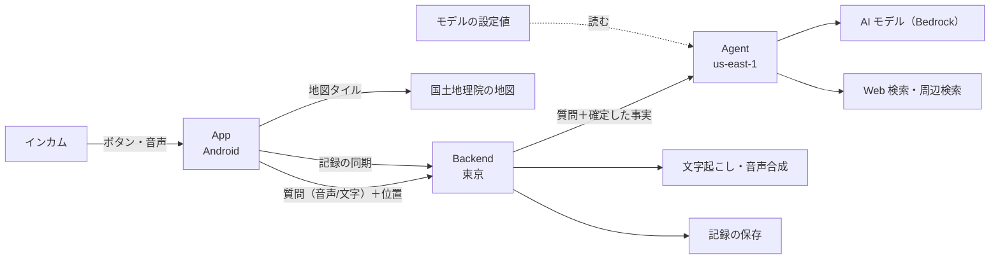

# 技術方針

プロジェクト全体に効く技術の方針と選定を、基本設計の粒度で定める。
各ユニットの中の詳細な設計（データの項目、処理の手順、数値の設定など）はここに書かず、ユニットごとの設計で決める。

要件は [01_requirements.md](01_requirements.md)・[04_detailed_requirements.md](04_detailed_requirements.md)、ユニットの責務は [06_units_definition.md](06_units_definition.md)、ユニット間の約束は [07_units_contracts.md](07_units_contracts.md)。

## 1. 概要

走行中は画面を見られず、手も使えない。この前提で、ライダーがインカムのボタンと声だけで AI と対話でき、その会話と走ったルートが記録として残るようにする。

| 担い手 | 仕事 |
|---|---|
| アプリ（端末） | 起動を受ける・録音する・位置とルートを記録する・質問を送る・回答を鳴らす・ナビへ戻す・記録を端末に持ち、クラウドと同期する・地図で振り返る |
| クラウド | 事実（住所・方位・日時）を確定する・音声を文字にする・回答を考える（必要なら調べる）・読み上げの音声を作る・記録をユーザー名ごとに保存する |

賢い処理（回答の生成・文字起こし・事実の確定）はクラウドに置き、アプリは「端末でしかできないこと」に徹する。

## 2. 全体構成

## 3. レイヤーの方針

### App

- 端末でしかできないことを持つ: インカムのボタンからの起動、録音、位置とルートの記録、回答の再生、ナビのアプリへの復帰、地図の表示。
- 回答の生成・文字起こし・住所の確定などのロジックは持たない。
- アプリが背面にあっても、走行の記録・回答の待ち受け・読み上げを続けられる作りにする（Android の常駐の仕組みを使う）。走行中に画面を前面に出し続けないため。
- 記録は端末に持ち、通信できるときにクラウドと同期する。通信できないあいだの記録（ルート・質問できなかった地点・地点メモ）は端末に溜め、後から送る。
- 走行中に見る画面は、色と大きな文字だけで状態が分かるようにし、失敗は音で知らせる。

### Backend

- 門番: 接続キーの確認・流量の制限・入力の検証を、AI を呼ぶ前に行う。
- 音声の質問は、ストリーミングの文字起こしで文字にする。バッチの文字起こしは待ち時間の揺れが大きい（[adr/0002](../adr/0002-streaming-transcription.md)）。
- AI に渡す前に事実を確定させる。座標から住所、位置の履歴から進行方位、現在日時を Backend が求めて添える。調べれば確定するものを AI に推測させない。
- 音声: 質問の音声を文字にし、回答の読み上げ音声を作る。地点メモの声は文字にするだけで、AI には渡さない。
- 回答は非同期で返す（回答の生成は API の応答時間の上限を越えうるため）。
- 記録（走行・質問・地点メモ・メモ）をユーザー名ごとに保存し、端末との同期の窓口になる。
- 音声は長く残さない（文字にするための一時的な保管にとどめる）。

### Agent

- 会話の文脈の保持・回答の生成・Web 検索・周辺検索を担う。
- 回答は読み上げる前提の文体（短く、記号を使わない）で作る。
- 能力の拡張は、ツールを足す形で行う。
- 会話の文脈は、同じ会話の識別子で呼ばれるあいだ、AI の実行環境のセッションの中に保つ。会話は最後の質問から一定の時間で区切るので、セッションの寿命の内に収まる。過去のツールの結果は次の質問に持ち越さず、入力を小さく保つ（[adr/0003](../adr/0003-conversation-context.md)）。
- 使う AI モデルは設定値から読む（§5）。

### CICD

- Agent と Backend のデプロイを担う。デプロイの仕組み（権限・手順）は非公開のユニットに置く。
- App の配布（知人向けのテスト配信）は App の側で自動化し、CICD はその設定手順を持つ。

## 4. データの持ち方

| データ | 端末 | クラウド | 方針 |
|---|---|---|---|
| 質問と回答の文字・ルート・地点メモ・メモ・走行の名前 | 持つ | 持つ | すべて残す。消えるのは利用者が削除したときだけ |
| 質問の音声（確認用） | 直近の数件だけ | 持たない | 録音の確認のためだけに残す |
| 質問・地点メモの音声（処理中） | — | 一時的に | 文字にしたら消す |
| 回答の音声 | 再生するあいだだけ | 一時的に | 残さない |
| 設定（ユーザー名・接続キー・各種の設定） | 持つ | 持たない | 接続キーは端末の安全な領域に保管する |

- 記録はユーザー名で分ける。接続キーは身内で共通のものを使い、記録の分け方には関わらない。
- 同じユーザー名を設定した端末どうしでは、同じ記録が見える（引き継ぎ）。
- 端末とクラウドの両方で変更・削除が起こりうるので、同期は同じ記録を何度送っても壊れない作りにする。
- 位置と会話の記録は個人情報として扱う。ログに出すときは必要な範囲にとどめる。

## 5. AI モデルの管理

AI モデルは新しいものが次々に出るので、管理者が手間なく切り替えられることを設計の前提にする。

- 使うモデルは、コードに埋め込まず、クラウド側の設定値として一か所に置く。
- 管理者は設定値を変えるだけで切り替えられる。アプリの更新は要らない。Agent・Backend の作り直しも要らないようにする。
- 切り替えた後に、決まった質問で回答が返ることを確かめる手順を用意する（回答の文体・ツールの呼び出しが新しいモデルでも成り立つかを見るため）。
- 設定値が誤っていた・モデルが使えなくなったときは、失敗として利用者に音で知らせる（黙って止まらない）。どのモデルで失敗したかはログで分かるようにする。
- 何を使っているか・いつ切り替えたかを追えるようにする（設定値の変更の履歴を残す）。
- 最初に使うモデルは、構築の時点で Bedrock（Agent のリージョン）で使える Claude Sonnet 系の最新版から選ぶ。
- モデルに合わせて変えることがあるもの（システムプロンプトなど）は、モデルの設定値とは別に管理する。

## 6. 技術選定

| 対象 | 採用 | 理由 |
|---|---|---|
| 対象 OS | Android | インカムのボタンが出す起動の合図を受ける仕組みがある |
| App | React Native（Expo の Development Build）。足りないネイティブの機能は自前のモジュールで足す | JS/TS の知識が活きる。インカムの経路・常駐・ナビへの復帰にはネイティブが要る |
| 地図 | 国土地理院の地図タイル | 無償で使え、出典を表示すれば足りる |
| ハンズフリー起動 | インカムのボタンが出す音声コマンドの合図を受ける | 端末の既定のアシスタントを奪わずに済む |
| Backend | API Gateway ＋ Lambda（Python）。IaC は SAM | 門番・事実の確定・非同期の受け取りに素直 |
| 記録の保存 | DynamoDB | ユーザー名ごとの読み書きが中心で、量も小さい |
| Agent | Bedrock AgentCore（Strands） | 会話の実行環境と Web 検索のコネクタがある |
| AI モデル | Claude（Sonnet 系）。設定値で指定する（§5） | 回答の質。切り替えは設定で行う |
| 文字起こし／音声合成 | Amazon Transcribe ／ Amazon Polly | Lambda から呼べる。日本語に対応する |
| 周辺検索・住所 | Amazon Location Service | 座標から住所、周辺の施設を引ける |
| CI/CD | AWS CodeBuild（Agent・Backend）・GitHub Actions（App の配布） | App を AWS に依存させない |

## 7. リージョン

| 対象 | リージョン | 理由 |
|---|---|---|
| Backend・記録の保存 | 東京（`ap-northeast-1`） | 利用者が日本にいる |
| Agent | バージニア北部（`us-east-1`） | Web 検索のコネクタが使えるリージョンに合わせる |

リージョンをまたぐ呼び出しでは、呼び先のリージョンを明示する。

## 8. 前提と制約

- 回答の生成には時間がかかる（質問を送ってから読み上げまで、ふつう十数秒。検索を伴うと30秒前後）。待ち時間は画面か音で「止まっていない」ことが分かるようにし、既定では待たずにナビへ戻る。
- AI の実行環境はアイドル中も費用がかかりうる。費用が個人で負担できる範囲に収まるかを見ながら設定を決める。
- 走行中に画面を操作させない（法令上）。走行中に必要な操作はすべてインカムのボタンで完結させる。

## 9. 技術面の未確定事項

| 論点 | 何を決めるか |
|---|---|
| 背面での動作 | 回答の待ち受け・読み上げは決定済み（[adr/0004](../adr/0004-background-processing.md)）。ルートの記録を背面で続けられるかは、走行の記録を作るときに実機で確かめる |
| 会話の文脈の保持 | 決定済み（[adr/0003](../adr/0003-conversation-context.md)） |
| 同期のしかた | 端末とクラウドの記録の突き合わせ方（どちらの変更を優先するか、削除の伝え方） |
| モデルの設定値の置き場所 | 決定済み（[07_units_contracts.md](07_units_contracts.md) UC-2） |

## 10. やらないこと

[01_requirements.md](01_requirements.md) §8。
