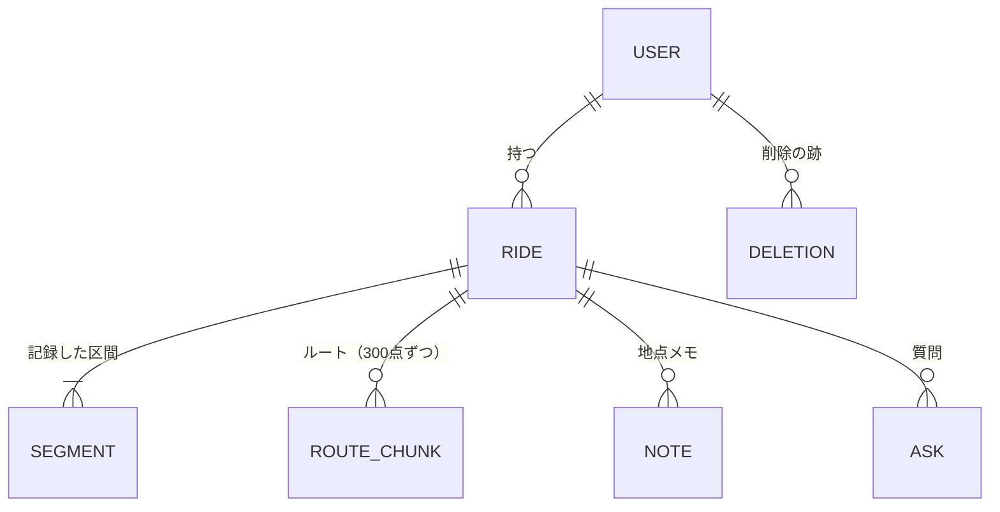

# データモデル

Android と Backend が受け渡す記録の論理モデル。記録の種類・識別子・関係・持ち主・新旧の決め方を定める。
項目の名前と型は [07a_openapi.yaml](07a_openapi.yaml)、送り方と読み込み方は [07_units_contracts.md](07_units_contracts.md) UC-7。
端末の DB の表は [08a_android-design.md](08a_android-design.md)、クラウドの DB のキーは [08b_backend-design.md](08b_backend-design.md)。

## 1. 全体

- 記録はユーザー名ごとに分かれる。ユーザー名の外の記録は見えない。
- 地点メモと質問は、いつもどれか1つの走行に入る（質問は走行の記録中だけ受ける。[adr/0008](../adr/0008-ask-only-while-recording.md)）。
- 会話は記録の種類にしない。質問が会話の識別子と「会話の最初の質問か」を持ち、それで区切りを表す。

## 2. 記録の種類

| 記録 | 識別子（作る側） | 中身 | 新旧の決め方 |
|---|---|---|---|
| 走行 | UUID（Android） | 名前・状態（記録中・一時停止中・終了）・記録した区間の並び・自動終了したか・走行のメモ | Android が変更した時刻（`updatedAt`） |
| 区間 | 走行の中の順番 | 始まりと終わりの時刻。一時停止は区間の切れ目で表す | 走行と一緒 |
| ルートのかたまり | 走行＋番号（Android） | 点（時刻・緯度・経度・精度）を記録した順に300点まで。番号 k には 300k 番目からの点が入る | 同じ番号は丸ごと置き換える |
| 地点メモ | UUID（Android） | 書いた日時・位置・方位の材料・本文・住所・進行方位 | `updatedAt` |
| 質問 | UUID（Backend が受け付けたもの） | 日時・位置・住所・方位・入力（声か文字）・質問の文・回答・失敗の理由・会話の識別子・会話の最初の質問か・会話のメモ | 回答は Backend が一度だけ書く。会話のメモは、メモを変えた時刻（`memoUpdatedAt`） |
| 質問できなかった地点 | UUID（Android） | 質問の一種（状態が「質問できなかった」）。日時・位置・方位の材料・住所・方位・会話のメモ。会話の識別子は無い | `updatedAt` |
| 削除の跡 | 消した記録の種類＋識別子 | 消した日時・走行（質問と地点メモのとき） | 期限なしで残る |

## 3. 持ち主と決まり

| 項目 | 決める側 |
|---|---|
| 走行・区間・ルート・地点メモの本文・会話のメモ・名前 | Android |
| 質問の文・回答・受け付けた日時・会話の識別子 | Backend |
| 住所・進行方位（質問・地点メモ・質問できなかった地点） | Backend。地点メモと質問できなかった地点は、最初に受けたときに決めて返し、あとから変えない |

- 端末が記録の正。クラウドは送られたものを置き、引き継ぎと読み直しのときに返す（[adr/0010](../adr/0010-read-the-cloud-only-when-taking-over.md)）。
- 同じ識別子の記録は1つにまとまる。何度送っても結果は同じ。
- 端末とクラウドの両方にある記録は、新旧の決め方（§2）で新しいほうを残す。
- 削除は跡を残す。跡のある記録と、跡のある走行の下の記録は、置き直せない（[adr/0009](../adr/0009-keep-deletion-marks-in-the-cloud.md)）。走行を消すと、その下のルート・地点メモ・質問も消える。
- 音声は記録に含めない。

## 4. 時刻と位置

- 時刻は UTC で受け渡す（端末の中ではミリ秒の数）。画面と AI への入力では日本時間にする。
- 位置は緯度・経度（WGS84）。進行方位は北を0とする度。
- 方位の材料は、位置の履歴から選んだ過去の1点とその時刻。方位そのものは Backend が求める。
