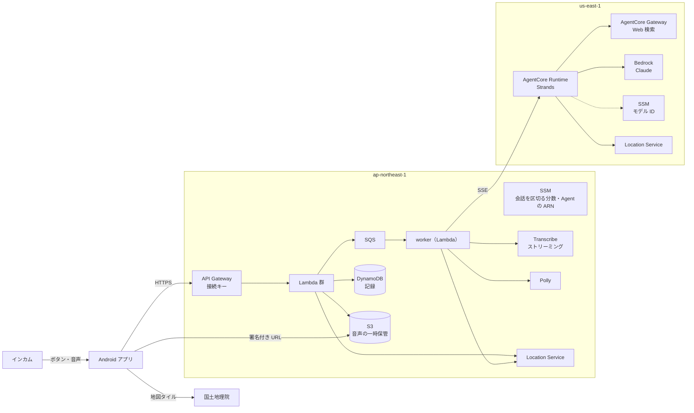
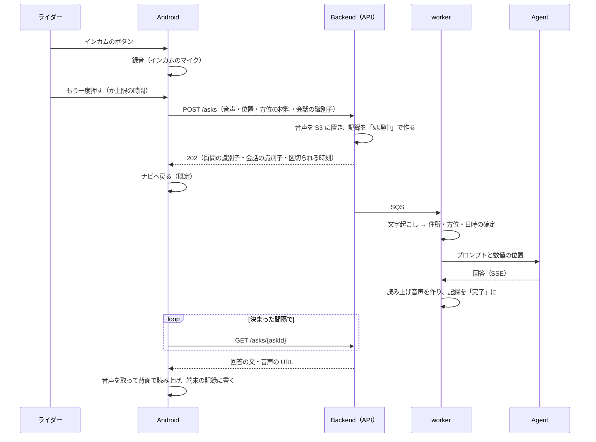
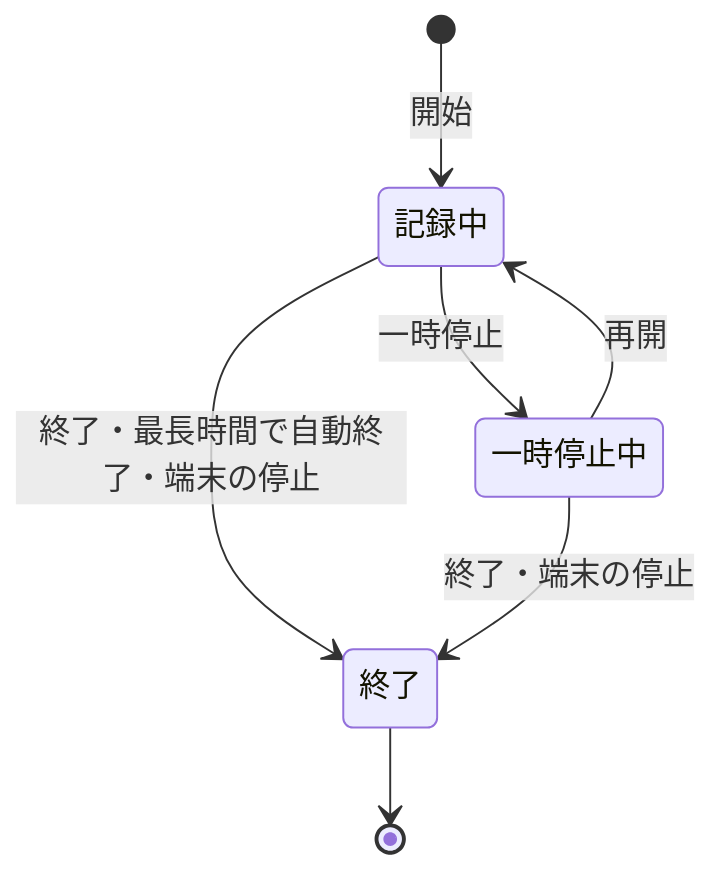
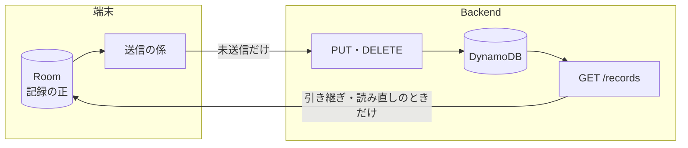

# 基本設計

システム全体がどう動くかを、コードを読まずに掴めるようにする。ユニットの中の作りは次の文書に分ける。

| 文書 | 中身 |
|---|---|
| [08a_android-design.md](08a_android-design.md) | Android の中の作り |
| [08b_backend-design.md](08b_backend-design.md) | Backend の中の作り |
| [08c_agent-design.md](08c_agent-design.md) | Agent の中の作り |

方針と技術の選定は [05_technical_policies.md](05_technical_policies.md)、ユニットの責務は [06_units_definition.md](06_units_definition.md)、ユニット間の約束は [07_units_contracts.md](07_units_contracts.md)・[07a_openapi.yaml](07a_openapi.yaml)・[07b_datamodel.md](07b_datamodel.md)。

## 書き方

- 基本設計の粒度にとどめる。クラスの中身・数値の細部・手順は書かない（数値は 04・07・07a に置く）。
- いまの決定だけを書く。経緯は書かず、理由が要るときは [adr/](../adr/README.md) を参照する。

## 1. 構成

- Android は端末でしかできないこと（ボタンの受け取り・録音・位置・再生・ナビへの復帰・地図）と、記録の正を持つ。
- Backend は門番と事実の確定（住所・方位・日時）・音声の処理・記録の置き場。Agent を呼ぶのは Backend だけ。
- Agent は会話の文脈と回答の生成・検索を持つ。Android とは直接話さない。

## 2. 質問の一巡

- 回答は非同期で返す。Android は打ち切りの時間まで取りに行き、失敗は音で知らせる。
- 会話の文脈は Agent の実行環境のセッションに持つ。区切るかは Android が決め、区切ったら会話の識別子を送らない（[adr/0003](../adr/0003-conversation-context.md)）。
- 質問を受けるのは走行の記録中だけ（[adr/0008](../adr/0008-ask-only-while-recording.md)）。
- 録音を終えた時点で通信できない・受け付けが通信の失敗に終わったときは、質問できなかった地点として端末に残し、後で送る。
- 地点メモの声は、同じ受け付けと取りに行く形で、文字起こしだけを頼む（`/transcriptions`。AI は呼ばない）。

## 3. 走行の記録

- 走行の状態とルートの点は、端末の DB に書く。記録中は前面サービスが Fused の位置を受け、背面でも画面を消しても記録を続ける（[adr/0006](../adr/0006-background-ride-recording.md)）。
- アプリが落ちても走行は続き、起動したときに DB から再開する。端末が止まったときは走行を終える。
- 最長時間の締め切りはアラームで置き、アプリが動いていなくても自動終了できる。

## 4. 同期

- 送る: 端末の記録は、送った版を覚えておき、変わったものだけを送る。契機は記録の変化・前面に来たとき・通信が戻ったときなど。通信できないあいだは溜める。
- 送る順は、削除 → 走行とルート → 地点メモ → 質問できなかった地点 → 会話のメモ。
- 断られたもの（400）は、その版を送り直さない。消されているもの（410）は送れたものと同じに扱う。
- 読む: 引き継ぎ（ユーザー名を変えるとき）と利用者が読み直すときだけ、ユーザーの記録をページ送りで全部読み、新しいほうを残して突き合わせる。削除の跡があれば端末から消す（[adr/0010](../adr/0010-read-the-cloud-only-when-taking-over.md)）。
- 質問と回答は Backend が作るので、Android から送り返さない。

## 5. 設定値

| 値 | 置き場所 | 読む側 |
|---|---|---|
| AI のモデル | SSM（us-east-1） | Agent（呼ばれるたび。短くキャッシュ） |
| 会話を区切る分数 | SSM（ap-northeast-1） | Backend（受け付けのたび） |
| Agent の実行環境の ARN | SSM（ap-northeast-1） | Backend のデプロイ |
| ユーザー名・接続キー・利用者の設定 | 端末（接続キーは Keystore で暗号化） | Android |

名前と値は [07_units_contracts.md](07_units_contracts.md) UC-2・UC-3・UC-5。

## 6. デプロイ

- Agent → Backend の順にデプロイする（Backend が Agent の ARN を読むため）。どちらも CICD（非公開）が持つ仕組みで行う。
- Android は走行用のビルドを端末に入れる。手順は Android の README。
