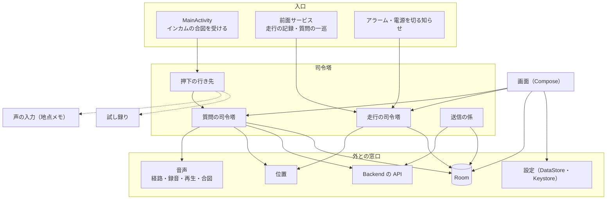

# Android の基本設計

Android アプリ（Kotlin・Jetpack Compose）の中の作り。全体の流れは [08_design.md](08_design.md)、画面は [02_screen_list.md](02_screen_list.md)・[03_screen_transition.md](03_screen_transition.md)、受け渡す記録は [07b_datamodel.md](07b_datamodel.md)。

## 1. 構成

- 部品の組み立ては1か所（`AppGraph`）で行い、各部品は窓口（interface）越しに外とつながる。判断の芯は Android に依存しない純粋な関数にして、JVM のテストで確かめる。
- パッケージは役割ごとに分ける。

| パッケージ | 役割 |
|---|---|
| `ask` | 質問の一巡の状態機械と司令塔・文字の質問のシートの状態・会話の識別子・失敗の読み上げ文 |
| `api` | Backend の API の呼び出し・回答を取りに行く処理（ポーリング）・Backend を呼ぶ口（`BackendAccess`） |
| `ride` | 走行の状態と計算・走行の司令塔・メモの長さの決まり |
| `location` | 質問の位置・走行のルートからの進行方位の計算・走行のルートの位置とふるい分け・位置の時刻で数えた今・位置と方位の確認（SC-22）の計算・質問の位置の窓口（`Positions`） |
| `audio` | インカムへの音声の経路・録音（PCM）・回答の再生・端末の音声合成・合図の音と、質問・試し録り・声の入力が使う窓口（`RouteControl`（札で借りる）・`Recorder`・`Cues` など） |
| `handsfree` | インカムの押下の重複の除外と行き先の振り分け |
| `voice` | 地点メモの声の入力 |
| `recordings` | 録音の確認（直近の録音と試し録り）と、録音を残す窓口（`RecordingSink`） |
| `sync` | 何を送るかの判断と送信 |
| `store` | Room の表と読み書き（Entity・DAO・移行はファイルを分けて置く） |
| `records` | 記録の画面の並べ方・メモ・地点メモの決まり |
| `map` | 地図（MapLibre と国土地理院のタイル） |
| `service` | 前面サービス・締め切りのアラーム |
| `settings`・`net`・`nav` | 設定と接続キー・通信できるか・ナビを開く |
| `ui`・`theme` | 画面とタブ |

## 2. 前面サービス

- 走行の記録中と質問の一巡のあいだは、1つの前面サービスを動かす。種類は、記録中は位置、一巡のあいだはマイクと再生を足す。何を動かすかは、走行と一巡の状態から決める（[adr/0005](../adr/0005-native-android-app.md)・[adr/0006](../adr/0006-background-ride-recording.md)）。
- これにより、アプリが背面にあっても画面が消えていても、位置の記録・回答の待ち受け・読み上げが続く。

## 3. 質問の一巡

- インカムのボタンは音声コマンドの合図として `MainActivity` に届く。押下の行き先は、試し録り中なら試し録り、地点メモを前面に表示しているなら声の入力、それ以外は質問。音声の経路はアプリに1つで、質問・試し録り・声の入力が札で1度に1人ずつ借りる。取り消した処理が後始末で次の持ち主の経路や位置を壊さないよう、経路の準備は取り消せ、札を返すのは最初の1回だけ効く。
- 質問の司令塔は、状態機械（録音中 → 送信 → 回答待ち → 読み上げ → 終わり）を進める。入口で走行の記録中かを確かめ、そうでなければ録音せずに理由を読み上げる。受け付けるかどうかの判断は1つの関数にあり、ホームのボタンもそれに従う。
- 録音の上限と開始の合図は、質問を始めるときに設定（SC-11）から読む。録音の確認の試し録りも同じ値を使う。
- 文字の質問は、同じ司令塔が送信から始める。Backend が受け付けたら入力のシートを閉じ、あとは声の質問と同じに進む。通信できずに送れなかったときは、質問できなかった地点を作らず、シートに文を残す。送っているあいだに取り消すと、シートはすぐ打ち直せる形に戻り、そのあと Backend が受け付けても、受け付けなかったものとして文を残す（Backend に残った質問は、声の質問と同じく受け入れる。その質問が新しい会話を始めていても、次の質問はその会話を続けない）。
- 質問を始めるときにメディアの音量を読む。対話の画面（SC-03）の低い音量の帯は、声の質問では録音中、文字の質問では送っているあいだと回答待ちに出す（回答はメディアの音で読み上げる。声の質問は録音のあと、インカムの経路が音を持つ）。
- 進行方位は端末で求める。今の走行の最後の区間のルートの点を DB から読み、新しい点から遡って、精度が足り今の位置から十分に離れた最初の点から、今の位置への向きにする（方針は [05_technical_policies.md](05_technical_policies.md) §3）。質問・質問できなかった地点・地点メモは、どれもこの計算を通る。パラメーターは設定に置く。
- 位置の時刻（GNSS の時刻のことがある）は端末の時計とずれうる。今の位置の新しさは起動からの経過時間で比べ、基準の点の古さ（保つ上限）は、受けた位置から求めた「位置の時刻で数えた今」と比べる。端末の時計とは比べない。「位置の時刻で数えた今」は、起動したときに端末の最後の位置からも覚える（一時停止中に作り直されたプロセスには、位置が来ないため）。
- 位置と方位の確認（SC-22）は、画面を開いているあいだ1秒ごとに同じ計算をする。今の位置は質問の録音と同じ1秒ごとの監視の最新。材料は、走行の記録中は走行のルート、それ以外（一時停止中を含む）は走行のルートと同じ頼み方とふるい分けで画面を開いてから集めた点（DB に書かない。走行のルートと同じく新しい120点まで）。画面を離れるか背面に回ると、監視を止めて集めた点を捨てる。
- 録音はインカムのマイクへの経路を張って行う。回答は音声の焦点を取らずに鳴らし、ナビの案内と重ねる。
- 戻る設定のときは、送った時点でナビを前面に出し、残りは背面で進める。
- 通信できずに送れなかったときは、質問できなかった地点として表に残す。

## 4. 走行の記録

- 走行の状態を変えるのは走行の司令塔だけ。画面・サービス・アラーム・電源を切る知らせは、どれもこれを呼ぶ。
- 位置は Fused から受け、ふるい分けた点をすぐ DB に書く。区間を始めた（再開した・プロセスが走行を引き継いだ）ときより前の点は捨てる。前後は端末の時計ではなく、起動からの経過時間で見分ける。
- 起動したときは、残っていた走行を片付ける（端末が止まっていれば終了、締め切りを過ぎていれば自動終了、それ以外は記録の再開）。端末が止まったかは、起動の回数と最後に生きていた時刻で見分ける。
- 最長時間の締め切りはアラームで置き、最長時間を変えたら置き直す。

## 5. 端末の DB（Room）

| 表 | 中身 |
|---|---|
| `rides` | 走行と、送信の印（送った版・断られた版） |
| `ride_segments` | 記録した区間 |
| `route_points` | ルートの点と、送ったかたまりの番号・断られた印 |
| `asks` | 質問（声か文字か・回答・失敗・質問できなかった地点）と会話のメモ。それぞれの送信の印。質問できなかった地点は端末で求めた方位 |
| `notes` | 地点メモと送信の印。端末で求めた方位と、Backend が返した住所 |
| `deletions` | 消した記録のうち、Backend にまだ届いていない削除 |
| `owner` | 端末の記録の持ち主（記録を持ち、送ってきたユーザー名）。1行だけ |

- 端末の DB が記録の正。画面はこの DB だけを読む。
- 記録の持ち主は `owner` にある。記録を入れ替える書き込みと同じトランザクションで書き換える（理由は [adr/0015](../adr/0015-record-owner-in-room.md)）。持ち主を書くのは、ユーザー名の変更（記録を読み込む書き込み）と、クラウドからの読み直し（持ち主の行が無いとき）と、送信の回（持ち主の行が無いとき）で、どれもそのときの設定のユーザー名を持ち主にする。設定を読めずに仮に作ったユーザー名は、持ち主にしない（読み直しも送信もしない）。
- 記録を消すときは、同じトランザクションで削除の印を書く。
- スキーマを変えるときは版を上げて移行を書き、破壊的に作り直さない。

## 6. 送信と読み込み

- 送信の係は、契機（記録の変化・前面に来たとき・起動・通信が戻ったとき・接続キーとユーザー名の変更）ごとに、まず設定のユーザー名が記録の持ち主かを確かめ、合うときだけ未送信を調べて、あるものだけを送る。合わないとき（持ち主と違う名前になっている・設定を読めなかった起動で名前が未確定）は何も送らず、SC-14 と SC-18 に知らせる。通信できないあいだは試さない。通信が戻ったことは、システムの知らせを受けたところで回数として数えるので、ごく短い切断も契機になる。
- 何を送るかの判断は純粋な関数に分ける。送る順と、400・410 の扱いは [08_design.md](08_design.md) §4。
- 質問できなかった地点を書けたら、すぐ送信の契機にする（通信の失敗でも、既定のネットワークは残っていることがある）。住所を決められずに受け付けられた地点メモと質問できなかった地点は、起動ごとに一度、版を進めて送り直す（Backend は新しい版のときだけ住所を求め直す）。
- 読み込み（引き継ぎ・読み直し）は、読み込みの係が `GET /records` を最後のページまで読んでから、端末の記録の読み出し・突き合わせ・書き込みを1つのトランザクションで行う。途中で失敗したら端末は何も変わらない。突き合わせの決まりは純粋な関数に分ける（決まりは [07_units_contracts.md](07_units_contracts.md) UC-7）。
- ユーザー名を変えるときは、先に名前を保存し、同じトランザクションで端末の記録（送っていない削除の印も）を消してから入れ、会話の文脈を切る。名前を保存できなければ何も変えない。記録を入れられなかった（止まった・失敗した）ら、名前を元に戻す。名前（DataStore）と記録（Room）は1つのトランザクションにできないので、食い違うのは、入れる失敗と戻す保存の失敗が重なったときだけにする。名前を保存してから戻すまでは、取り消されても止めない。戻す保存も失敗したら、SC-18 に、名前は変わったが記録は前の名前のままであることを出す。読み始めから戻すまでは、送信の回を走らせない（入れた記録の送り直しや新しい記録が、食い違った名前に届かないため）。
- 走行の記録中・一時停止中は、名前の変更も読み直しもしない。名前の変更は、未送信があるあいだと、走行の書き込みが書き直し待ちのあいだもしない（書き直しが、新しい名前の記録に古い名前の走行を書かないため）。書き直しは走行の司令塔の次の呼び出しで行うので、走行が無いあいだは SC-18 を開いたときに試し、それでも書けなければ、送信ではなく書き込みの問題として出す。未送信は、次の送信の回が送るもの（質問できなかった地点・走行・地点メモ・会話のメモ・削除の印。断られた版と、記録中の走行は数えない）で、データの保存（SC-14）の内訳と同じ数を使う。トランザクションの中でも確かめ直し、止まった理由（走行・未送信・書き直し待ち）を画面に出す。止める条件は1つの関数にまとめ、画面とトランザクションの両方がそれを通す。持ち主と設定の名前が食い違っているあいだは、その未送信の記録は持ち主のものなので、画面は未送信では止めない。持ち主の名前へ戻すときは、記録を入れ替えずにクラウドの記録を足すだけで、未送信が残る。ほかの名前へ変えるときは、トランザクションが未送信で止める。食い違ったままの読み直し（今の名前の記録を、別の持ち主の記録に足すこと）は断る。未送信を数え終えるまでは、SC-14 と設定の行に保存の状態を出さず、SC-18 の変更も押せない。数えた値は、どの画面も読まなくなってしばらくすると捨て、画面に戻ったときは数え直す（古い数を一瞬出さないため）。走行の書き直し待ちは、書き込みが失敗したあとだけで、書いているあいだは書き直し待ちにしない。
- 読み込みはアプリの範囲で走り、画面を離れても続く。一度に1つだけ。

## 7. 設定と保存

- 設定を読めなかった起動では、ユーザー名はその起動だけの仮の名前で、何も書かない（記録の持ち主と取り違えないため）。名前が確定するのは、設定が空だった（初めての起動）ときと、利用者が SC-18 で名前を選んだときだけ。設定の更新は、画面が持つ古い写しではなく、画面が変えた項目だけを最新の設定に重ねる。ユーザー名は名前の変更の保存でしか変わらない。
- 利用者の設定は DataStore に、接続キーは Keystore で暗号化して置く。最後に保存した時刻（送信の回が最後まで失敗せずに終わった時刻）も DataStore に、設定とは別のキーで置く。
- 質問の録音は、確認のために直近10件だけをアプリの領域に置く。録音は送る前に置き、古い録音を消すのは、その録音が残ると分かったとき（Backend が受け付けた・断った）にする（質問できなかった地点になって消える録音のために、古い録音を消さない）。
- 地図のスタイルはアプリに同梱し、タイルは国土地理院から取る。
