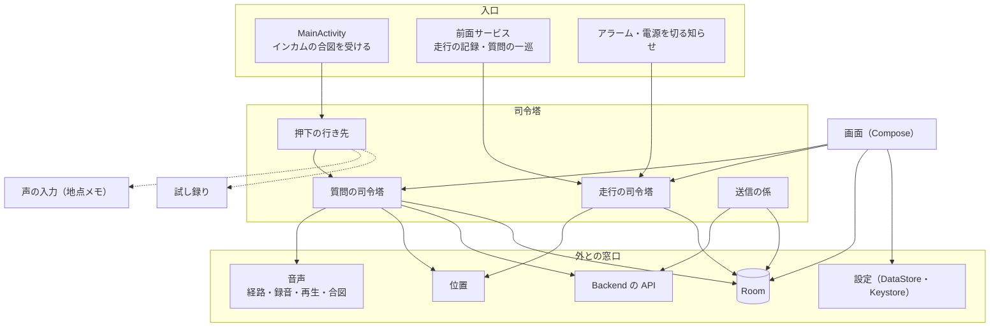

# Android の基本設計

Android アプリ（Kotlin・Jetpack Compose）の中の作り。全体の流れは [08_design.md](08_design.md)、画面は [02_screen_list.md](02_screen_list.md)・[03_screen_transition.md](03_screen_transition.md)、受け渡す記録は [07b_datamodel.md](07b_datamodel.md)。

## 1. 構成

- 部品の組み立ては1か所（`AppGraph`）で行い、各部品は窓口（interface）越しに外とつながる。判断の芯は Android に依存しない純粋な関数にして、JVM のテストで確かめる。
- パッケージは役割ごとに分ける。

| パッケージ | 役割 |
|---|---|
| `ask` | 質問の一巡の状態機械と司令塔・回答を取りに行く処理・会話の識別子・失敗の読み上げ文 |
| `ride` | 走行の状態と計算・走行の司令塔 |
| `location` | 質問の位置と方位の材料・走行のルートの位置とふるい分け |
| `audio` | インカムへの音声の経路・録音（PCM）・回答の再生・端末の音声合成・合図の音 |
| `handsfree` | インカムの押下の重複の除外と行き先の振り分け |
| `voice` | 地点メモの声の入力 |
| `recordings` | 録音の確認（直近の録音と試し録り） |
| `sync` | 何を送るかの判断と送信 |
| `store` | Room の表と読み書き |
| `records` | 記録の画面の並べ方・メモ・地点メモの決まり |
| `map` | 地図（MapLibre と国土地理院のタイル） |
| `service` | 前面サービス・締め切りのアラーム |
| `settings`・`net`・`nav` | 設定と接続キー・通信できるか・ナビを開く |
| `ui`・`theme` | 画面とタブ |

## 2. 前面サービス

- 走行の記録中と質問の一巡のあいだは、1つの前面サービスを動かす。種類は、記録中は位置、一巡のあいだはマイクと再生を足す。何を動かすかは、走行と一巡の状態から決める（[adr/0005](../adr/0005-native-android-app.md)・[adr/0006](../adr/0006-background-ride-recording.md)）。
- これにより、アプリが背面にあっても画面が消えていても、位置の記録・回答の待ち受け・読み上げが続く。

## 3. 質問の一巡

- インカムのボタンは音声コマンドの合図として `MainActivity` に届く。押下の行き先は、試し録り中なら試し録り、地点メモを開いているなら声の入力、それ以外は質問。
- 質問の司令塔は、状態機械（録音中 → 送信 → 回答待ち → 読み上げ → 終わり）を進める。入口で走行の記録中かを確かめ、そうでなければ録音せずに理由を読み上げる。
- 録音はインカムのマイクへの経路を張って行う。回答は音声の焦点を取らずに鳴らし、ナビの案内と重ねる。
- 戻る設定のときは、送った時点でナビを前面に出し、残りは背面で進める。
- 通信できずに送れなかったときは、質問できなかった地点として表に残す。

## 4. 走行の記録

- 走行の状態を変えるのは走行の司令塔だけ。画面・サービス・アラーム・電源を切る知らせは、どれもこれを呼ぶ。
- 位置は Fused から受け、ふるい分けた点をすぐ DB に書く。
- 起動したときは、残っていた走行を片付ける（端末が止まっていれば終了、締め切りを過ぎていれば自動終了、それ以外は記録の再開）。端末が止まったかは、起動の回数と最後に生きていた時刻で見分ける。
- 最長時間の締め切りはアラームで置き、最長時間を変えたら置き直す。

## 5. 端末の DB（Room）

| 表 | 中身 |
|---|---|
| `rides` | 走行と、送信の印（送った版・断られた版） |
| `ride_segments` | 記録した区間 |
| `route_points` | ルートの点と、送ったかたまりの番号・断られた印 |
| `asks` | 質問（回答・失敗・質問できなかった地点）と会話のメモ。それぞれの送信の印 |
| `notes` | 地点メモと送信の印。Backend が返した住所と方位 |
| `deletions` | 消した記録のうち、Backend にまだ届いていない削除 |

- 端末の DB が記録の正。画面はこの DB だけを読む。
- 記録を消すときは、同じトランザクションで削除の印を書く。
- スキーマを変えるときは版を上げて移行を書き、破壊的に作り直さない。

## 6. 送信と読み込み

- 送信の係は、契機（記録の変化・前面に来たとき・起動・通信が戻ったとき・接続キーとユーザー名の変更）ごとに未送信を調べ、あるものだけを送る。通信できないあいだは試さない。
- 何を送るかの判断は純粋な関数に分ける。送る順と、400・410 の扱いは [08_design.md](08_design.md) §4。
- 質問できなかった地点を書けたら、すぐ送信の契機にする（通信の失敗でも、既定のネットワークは残っていることがある）。住所を決められずに受け付けられた地点メモと質問できなかった地点は、起動ごとに一度、版を進めて送り直す（Backend は新しい版のときだけ住所を求め直す）。
- 読み込み（引き継ぎ・読み直し）は、読み込みの係が `GET /records` を最後のページまで読んでから、端末の記録の読み出し・突き合わせ・書き込みを1つのトランザクションで行う。途中で失敗したら端末は何も変わらない。突き合わせの決まりは純粋な関数に分ける（決まりは [07_units_contracts.md](07_units_contracts.md) UC-7）。
- ユーザー名を変えるときは、同じトランザクションで端末の記録（送っていない削除の印も）を消してから入れ、書き終えてから名前を保存し、会話の文脈を切る。読み始めから名前の保存までは、送信の回を走らせない（名前を保存する前に送ると、入れた記録の送り直しが古い名前に届くため）。
- 走行の記録中・一時停止中は、名前の変更も読み直しもしない。名前の変更は、未送信があるあいだ（走行の書き込みが書き直し待ちのときを含む）もしない。未送信は、次の送信の回が送るもの（質問できなかった地点・走行・地点メモ・会話のメモ・削除の印。断られた版と、記録中の走行は数えない）で、データの保存（SC-14）の内訳と同じ数を使う。トランザクションの中でも確かめ直す。
- 読み込みはアプリの範囲で走り、画面を離れても続く。一度に1つだけ。

## 7. 設定と保存

- 利用者の設定は DataStore に、接続キーは Keystore で暗号化して置く。最後に保存した時刻（送信の回が最後まで失敗せずに終わった時刻）も DataStore に、設定とは別のキーで置く。
- 質問の録音は、確認のために直近10件だけをアプリの領域に置く。
- 地図のスタイルはアプリに同梱し、タイルは国土地理院から取る。
