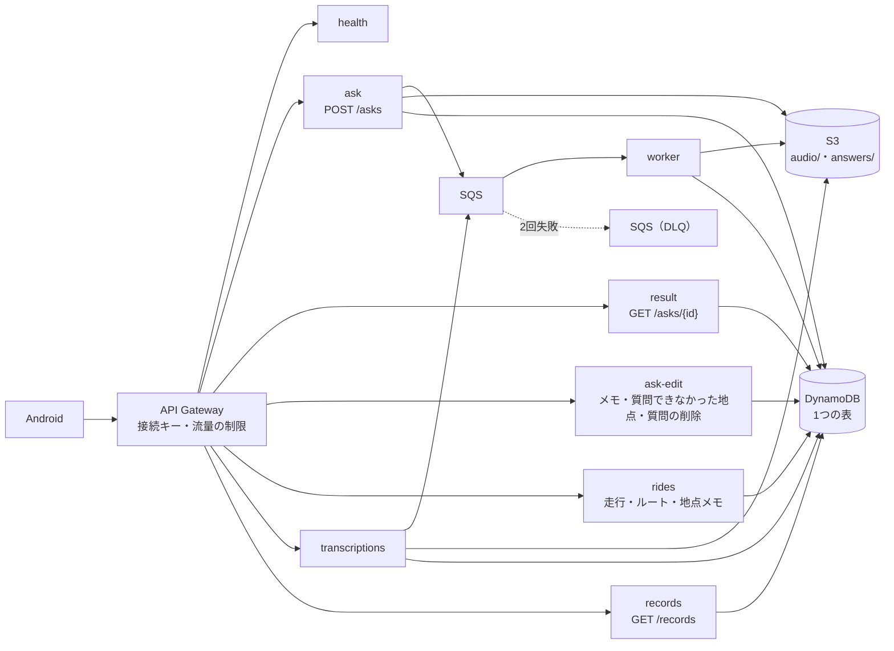

# Backend の基本設計

Backend（API Gateway＋Lambda・Python・SAM・`ap-northeast-1`）の中の作り。全体の流れは [08_design.md](08_design.md)、API の項目は [07a_openapi.yaml](07a_openapi.yaml)、記録の種類は [07b_datamodel.md](07b_datamodel.md)。

## 1. 構成

- 経路ごとに Lambda を分け、権限をその経路に要るものだけにする。ハンドラは出入りだけにして、入力の検証・記録の読み書き・種類ごとの手順（最初に受けた値を残す・質問の記録の形と読み出し）は共通の部品（`src/lib/`）に置く。`lib` は `handlers` を読まない。
- 重い処理（文字起こし・Agent・音声合成）は worker だけが行う。API の Lambda は検証して積むだけで、すぐ返す。
- 接続キーと流量の制限（1日の上限と毎秒の上限）は API Gateway の使用量プランで行う（死活の確認だけは接続キーが要らない）。ユーザー名はヘッダから読み、形式を Lambda が確かめる。

## 2. 質問の処理（worker）

1. 受け付け（`ask`）: 入力を確かめ、音声を S3 の `audio/` に置き、質問の記録を「処理中」で作って SQS に積む。積めなければ記録と音声を消して 503 を返す。会話を区切る時刻は SSM の分数から求めて返す。
2. worker は条件付きの書き込みで受け持ちを取り（同じメッセージが2度来ても1回だけ処理する）、次の順に進める。
   - 文字起こし（Transcribe のストリーミング。[adr/0002](../adr/0002-streaming-transcription.md)）
   - 住所（Location Service）・現在日時を確定し、受けた進行方位（古い版の方位の材料なら、そこから求める）と合わせて、プロンプトを組む
   - Agent を呼ぶ（us-east-1。セッションの識別子はユーザー名と会話の識別子から作る）
   - 回答を読み上げ音声にする（Polly。利用者が選んだ量だけ音量を上げる）。S3 の `answers/` に置く。API は音声の取り先を一覧で返すが、いまは1件
3. 記録を「完了」か「失敗（理由つき）」にする。トークン数と使ったモデルも残す。
4. `result` は記録を読み、完了なら音声の署名付き URL を付けて返す。

地点メモの声（`transcriptions`）は同じ受け付けと worker を通り、文字起こしだけで終える。

## 3. 記録の置き方（DynamoDB）

1つの表に、ユーザーごとのパーティションで置く。

| 記録 | パーティションキー | ソートキー | 消えるとき |
|---|---|---|---|
| 走行 | `USER#<ユーザー名>` | `RIDE#<走行>` | 削除 |
| ルートのかたまり | 〃 | `RIDE#<走行>#ROUTE#<番号>` | 走行の削除 |
| 地点メモ | 〃 | `RIDE#<走行>#NOTE#<地点メモ>` | 削除・走行の削除 |
| 質問（質問できなかった地点を含む） | 〃 | `ASK#<質問>` | 削除・走行の削除 |
| 削除の跡 | 〃 | `DELETED#<種類>#<識別子>` | 消えない |
| 会話（区切る時刻など） | 〃 | `CONV#<会話>` | TTL（1日） |
| 文字起こしの依頼 | 〃 | `TRANSCRIPTION#<依頼>` | TTL（1日） |

- 走行の下の記録は走行の識別子で前方一致させるので、走行を消すときに一度の問い合わせでまとめて集められる。
- 新旧の判定（`updatedAt`）は条件付きの書き込みで行う。古い版は書かずに「受け取った」と返す。
- 削除の跡を見て書く書き込みは、書き込みと跡の確かめを1つのトランザクションにする（跡があれば 410）。削除は先に跡を書いてから消す（[adr/0009](../adr/0009-keep-deletion-marks-in-the-cloud.md)）。
- `GET /records` はパーティションをソートキーの順に強い一貫性で読み、1回の問い合わせを1ページとして返す。
- 表は時点復旧（PITR）を有効にする。

## 4. 音声の保管（S3）

| 置き場 | 中身 | 残す期間 |
|---|---|---|
| `audio/` | 質問・地点メモの録音 | 1日（ライフサイクルで消す） |
| `answers/` | 回答の読み上げ音声 | 1日。Android は署名付き URL で直接取る |

バケットは公開せず、暗号化する。

## 5. 失敗の扱い

- 入力の不正は 400 と理由。接続キーの誤りは API Gateway が 403 を返す。
- worker の各段の失敗は、質問の記録の失敗の理由（`transcribe_failed`・`agent_failed`・`tts_failed`・`no_speech`）にする。
- worker が落ちたメッセージは SQS が送り直し、2回失敗したら DLQ に移す。
- Agent の呼び出しは自動で送り直さない（同じ質問が会話に2回入るため）。

## 6. 設定とデプロイ

- 会話を区切る分数は SSM（`/trv2/<env>/conversation-reset-minutes`）から受け付けのたびに読む。
- Agent の ARN は SSM（`/trv2/<env>/agent-runtime-arn`）からデプロイのときに読み、worker の環境と権限に入れる。
- SAM でデプロイする（スタック名とデプロイの手順は Backend の README）。
