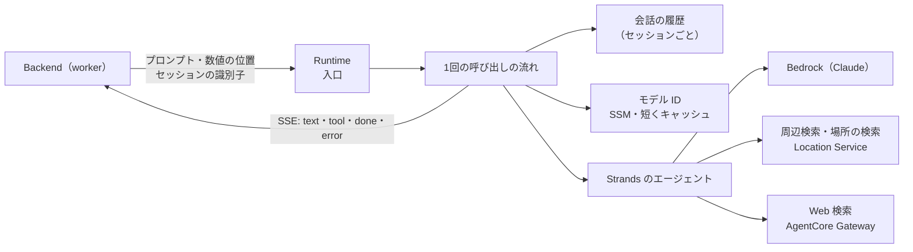

# Agent の基本設計

Agent（Bedrock AgentCore Runtime＋Strands・Python・`us-east-1`）の中の作り。全体の流れは [08_design.md](08_design.md)、Backend との約束は [07_units_contracts.md](07_units_contracts.md) UC-8。

## 1. 構成

- 入口は組み立てだけを行い、1回の呼び出しの流れは別の部品に置く（テストでは作り物のエージェントを渡す）。
- エージェントは質問ごとに作り直す。モデル ID の切り替えと、ツールの呼び出しの数え直しを質問ごとに効かせるため。
- Web 検索が使えないとき（Gateway の URL が無い・つなげない）は、Web 検索なしで答える。
- Web 検索の MCP の接続は、エージェントを作り直してもプロセスの中で使い回す（質問ごとにつなぎ直す時間を省くため）。つなげなかったとき・つないだ接続が生きていないとき・前の質問で Web 検索が失敗したとき・一定の時間（Runtime の環境変数）使わなかったときは、次の質問の前につなぎ直す。

## 2. 1回の呼び出しの流れ

1. SSM からモデル ID を読む（キャッシュが新しければそれを使う）。読めなければ `error` を返す。
2. セッションの識別子でそれまでの履歴を取り出し、エージェントを作る。
3. Backend が組んだプロンプトをそのまま渡し、回答の断片とツールの呼び出しを SSE で流す。
4. 最後のツールの呼び出しより後ろの文を回答とし（前置きを除く）、トークン数とモデル ID を添えて `done` で返す。周回の上限に達して回答の文が無いときは、決まった文（「調べきれませんでした。」）を回答にする（モデルをもう一度は呼ばない）。
5. 履歴からツールの呼び出しと結果を取り除き、質問と回答の文だけを直近の数件まで残す。

## 3. 会話の文脈

- 会話の履歴は Runtime のプロセスの中に、セッションの識別子ごとに持つ。同じ識別子で呼ばれるあいだは同じセッションに届く（[adr/0003](../adr/0003-conversation-context.md)）。
- 会話を区切るのは Android。Agent は区切りを知らず、新しい識別子が来れば新しい会話になる。
- Runtime のアイドルの時間切れは、会話を区切る時間の上限より長くする。

## 4. ツール

| ツール | 中身 |
|---|---|
| 周辺検索 | 種類で現在地の周辺の施設を探し、距離・方角・進行方向に対する左右を計算して返す |
| 場所の検索 | 名前で場所を探し、同じく距離・方角・左右を返す |
| Web 検索 | AgentCore Gateway のコネクタを MCP で呼ぶ |

- 現在地と方位は、プロンプトとは別に数値で受け、ツールが直接読む（AI に座標を書き写させない）。
- 入力を小さく保つため、1回の質問でのツールの呼び出しの数と、ツールの結果の文字数に上限を置く。上限は Runtime の環境変数。
- ツールを足すときは、ここに1行足し、エージェントの組み立てに加える。

## 5. 設定とデプロイ

- モデル ID は SSM（`/trv2/<env>/agent-model-id`）。切り替えはこの値を変えるだけで、作り直しは要らない。
- システムプロンプトはコードに置く（読み上げ向けの文体・推測しないことなど）。
- Runtime と Gateway は AgentCore の CLI でデプロイし、ARN を SSM（`ap-northeast-1` の `/trv2/<env>/agent-runtime-arn`）に書く。手順は Agent の README。
